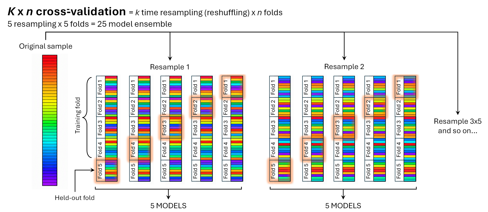

## What we will explore

In the previous chapter, we fitted one model and obtained one set of optimized parameters. We will now ask:

- Would the parameters change if we fitted a different subset of the observations?
- How well does each model predict observations that were not used for fitting?
- Where are the spatial parameter estimates stable, and where are they uncertain?

We will move through the ideas in a simple order:

**one train/test split → k-fold cross-validation → repeated cross-validation → ensembles → parameter and prediction ranges → spatial uncertainty maps**

::: {.callout-tip title="The key change in perspective"}
The previous chapter asked, **“What is the best fitted model?”**
This chapter asks, **“How much does the fitted answer change?”**
:::

## Setup and short recap

Install the packages once if needed.

```{r}
#| eval: false
install.packages(c("readr", "minpack.lm", "pso", "randomForest", "terra", "spData"))
```

Load the packages.

```{r}
library(readr)
library(minpack.lm)
library(randomForest)
```

Set the validation choices.

```{r}
#| label: settings

min_drydown_steps <- 5
k_folds <- 5
n_repeats <- 10
analysis_seed <- 100
```

### Read the simplified data

```{r}
#| label: download-site-data

csv_url <- paste0(
  "https://github.com/Vinit-Sehgal/AGRO4092/raw/refs/heads/main/",
  "SampleData-master/US-TON_SM-EF.csv"
)

download.file(
  csv_url,
  destfile = "US-TON_SM-EF.csv",
  mode = "wb"
)
```

```{r}
#| label: read-site-data
#| warning: false

# Read the date column as text before parsing it explicitly.
eddy_data <- read_csv(
  "US-TON_SM-EF.csv",
  col_types = cols(date = col_character()),
  show_col_types = FALSE
)

# The source file uses month/day/year, such as 5/7/2001.
eddy_data$date <- as.Date(eddy_data$date, format = "%m/%d/%Y")
stopifnot(!anyNA(eddy_data$date))
eddy_data <- eddy_data[order(eddy_data$date), ]
```

### Recreate the drydown data

```{r}
#| label: drydown-data

# Identify consecutive non-increasing SM steps.
eddy_data$SM_change <- c(NA_real_, diff(eddy_data$SM))
eddy_data$is_drydown <-
  is.finite(eddy_data$SM_change) & eddy_data$SM_change <= 0

# Keep each drydown event intact for later resampling.
eddy_data$drydown_id <- cumsum(!eddy_data$is_drydown)
eddy_data$drydown_length <- ave(
  eddy_data$is_drydown,
  eddy_data$drydown_id,
  FUN = sum
)

drydown_data <- subset(
  eddy_data,
  is_drydown &
    drydown_length >= min_drydown_steps &
    is.finite(SM) &
    is.finite(EF)
)

drydown_data$observation_id <- seq_len(nrow(drydown_data))

cat("Observations:", nrow(drydown_data), "\n")
cat("Drydown events:", length(unique(drydown_data$drydown_id)), "\n")
```

::: {.callout-important title="Keep complete drydowns together"}
Neighboring observations from one drydown are not independent.
We will assign whole drydown events—not individual rows—to training or validation groups.
This reduces information leakage.
:::

### Reuse the physical model and fitting function

The chapter is self-contained, so we repeat the same physical equation, bounds, and `minpack.lm::nlsLM()` function used in Chapter 13.
Keeping the implementation identical ensures that validation measures changes caused by resampling rather than changes in the model code.

```{r}
#| label: model-and-nls-functions

piecewise_EF <- function(SM, theta_d, theta_w, EF_max) {
  # Apply the three physical regimes to every SM value.
  ifelse(
    SM <= theta_d,
    0,
    ifelse(
      SM >= theta_w,
      EF_max,
      EF_max * (SM - theta_d) / (theta_w - theta_d)
    )
  )
}

fit_NLS <- function(SM, EF) {
  # Remove pairs with missing or non-finite values.
  keep <- is.finite(SM) & is.finite(EF)
  SM <- SM[keep]
  EF <- EF[keep]

  # Return this fixed-length vector when a fit is not possible.
  empty_result <- c(
    theta_d = NA_real_,
    theta_w = NA_real_,
    EF_max = NA_real_
  )

  # A nonlinear fit needs enough observations and SM variation.
  if (length(SM) < 10 || length(unique(SM)) < 4) {
    return(empty_result)
  }

  # Recalculate the same bounds for the data supplied to this fit.
  lower <- c(
    theta_d = 0.02,
    theta_w = unname(quantile(SM, 0.35)),
    EF_max = 0.20
  )
  upper <- c(
    theta_d = unname(quantile(SM, 0.30)),
    theta_w = unname(quantile(SM, 0.98)),
    EF_max = 1.00
  )

  if (any(!is.finite(c(lower, upper))) || any(lower >= upper)) {
    return(empty_result)
  }

  # Start at the midpoint of each allowed parameter range.
  start <- (lower + upper) / 2
  model_data <- data.frame(SM = SM, EF = EF)

  fit <- minpack.lm::nlsLM(
    EF ~ piecewise_EF(SM, theta_d, theta_w, EF_max),
    data = model_data,
    start = as.list(start),
    lower = lower,
    upper = upper,
    control = minpack.lm::nls.lm.control(maxiter = 200)
  )

  parameters <- coef(fit)[c("theta_d", "theta_w", "EF_max")]
  setNames(as.numeric(parameters), names(empty_result))
}
```

Define the validation statistics once so every method is evaluated in the same way.

```{r}
#| label: validation-statistics

validation_stats <- function(observed, predicted) {
  # Compare only pairs for which both values are available.
  keep <- complete.cases(observed, predicted)
  observed <- observed[keep]
  predicted <- predicted[keep]

  rmse <- sqrt(mean((observed - predicted)^2))
  mae <- mean(abs(observed - predicted))
  bias <- mean(predicted - observed)

  r2 <- if (length(observed) > 2 &&
            sd(observed) > 0 &&
            sd(predicted) > 0) {
    cor(observed, predicted)^2
  } else {
    NA_real_
  }

  data.frame(RMSE = rmse, MAE = mae, Bias = bias, R2 = r2)
}
```

- **RMSE** gives more weight to large errors.
- **MAE** is the average absolute error.
- **Bias** is predicted minus observed EF.
- **$R^2$** describes association, but it does not measure agreement by itself.

## Begin with one train/test split

A model should be evaluated with observations that were not used to fit it.
We first use 80% of the drydown events for training and 20% for testing.
This simple split makes the idea of withheld prediction concrete, but its answer depends strongly on which events happen to be selected.

```{r}
#| label: train-test-split

set.seed(analysis_seed)
event_ids <- unique(drydown_data$drydown_id)
train_ids <- sample(event_ids, size = floor(0.80 * length(event_ids)))

# Whole events, rather than individual rows, go to one side of the split.
train_data <- subset(drydown_data, drydown_id %in% train_ids)
test_data <- subset(drydown_data, !drydown_id %in% train_ids)
```

Fit bounded NLS to the training events and predict the withheld test events.
`tryCatch()` lets the chapter continue with a clear missing result if this one fit fails.

```{r}
#| label: one-split-nls

empty_parameters <- c(
  theta_d = NA_real_,
  theta_w = NA_real_,
  EF_max = NA_real_
)

nls_train_parameters <- tryCatch(
  fit_NLS(train_data$SM, train_data$EF),
  error = function(e) empty_parameters
)

nls_test_prediction <- piecewise_EF(
  test_data$SM,
  nls_train_parameters["theta_d"],
  nls_train_parameters["theta_w"],
  nls_train_parameters["EF_max"]
)
```

Fit Random Forest to the same training events so the comparison uses exactly the same withheld observations.

```{r}
#| label: one-split-random-forest

set.seed(analysis_seed)
rf_train_fit <- randomForest(
  EF ~ SM,
  data = train_data,
  ntree = 500,
  mtry = 1,
  nodesize = 10
)
rf_test_prediction <- predict(rf_train_fit, newdata = test_data)
```

```{r}
#| label: one-split-statistics

one_split_results <- rbind(
  NLS = validation_stats(test_data$EF, nls_test_prediction),
  `Random Forest` = validation_stats(test_data$EF, rf_test_prediction)
)
one_split_results
```

::: {.callout-important title="Why one split is not enough"}
A favorable split can make a method look better than it usually is, while a difficult split can make it look worse.
One split also leaves 20% of the events out of model fitting and evaluates each method on only that one subset.
The result describes the chosen split, not the stability of the method across plausible splits.
:::

## Understand cross-validation before implementing it

**Cross-validation** is a structured way to repeat the train--test idea.
In $k$-fold cross-validation, we divide the drydown events into $k$ groups called folds.
We fit the model on $k-1$ folds, predict the fold that was held out, and rotate the held-out role until every fold has been tested once.

We keep complete drydown events together because neighboring observations within an event are related.
Splitting rows from one event across training and testing would let the model see close relatives of the validation observations and could make performance look unrealistically good.

{#fig-cross-validation fig-alt="A schematic of repeated cross-validation. An original colored sample is divided into five folds. In each model one fold is held out while the other four are used for training. The assignment is reshuffled for later repeats." width=100%}

The schematic shows two levels of repetition:

1. **Within one repeat**, each of the $k$ folds is held out once, producing $k$ fitted models.
2. **Across repeats**, the event-to-fold assignment is reshuffled and the full $k$-fold cycle is run again.

If we use $k$ folds and $n$ repeats, we fit as many as $k \times n$ models per method.
Here, 5 folds and 10 repeats produce up to 50 NLS fits and 50 Random Forest fits.
(Some diagrams reverse the letters used for folds and repeats; the important quantity is **folds × repeats**.)

Repeated $k \times n$ cross-validation is more informative than one train/test split because:

- every event is withheld once in each repeat;
- each fit still uses most of the events for training;
- reshuffling reveals how sensitive performance and parameters are to the split; and
- the many fitted models form an ensemble for summarizing prediction and parameter variation.

Cross-validation does not create independent new data, and its ensemble ranges are not formal confidence intervals.
It is a practical diagnostic of out-of-sample performance and resampling sensitivity.

## Implement repeated event-level cross-validation

The code below follows the explanation directly: assign folds, hold one out, fit on the rest, predict the held-out fold, store results, and repeat.

### Assign complete events to folds

```{r}
#| label: make-folds

make_folds <- function(data, k = 5, seed = 100) {
  set.seed(seed)

  # Shuffle event IDs, not individual observations.
  events <- sample(unique(data$drydown_id))
  fold_table <- data.frame(
    drydown_id = events,
    fold = rep(seq_len(k), length.out = length(events))
  )

  # Add the fold number back to every observation in each event.
  merge(data, fold_table, by = "drydown_id", all.x = TRUE, sort = FALSE)
}
```

```{r}
#| label: inspect-folds

example_folds <- make_folds(
  drydown_data,
  k = k_folds,
  seed = analysis_seed
)
table(example_folds$fold)
```

### Cross-validate the physics-based NLS model

```{r}
#| label: nls-cross-validation-function

cross_validate_NLS <- function(
    data,
    k = 5,
    repeats = 10,
    seed = 100) {

  parameters <- data.frame()
  statistics <- data.frame()
  predictions <- data.frame()

  for (repeat_id in seq_len(repeats)) {
    # Reshuffle events at the start of each repeat.
    cv_data <- make_folds(data, k = k, seed = seed + repeat_id)

    for (fold_id in seq_len(k)) {
      # Rotate one fold into validation; fit on all remaining folds.
      train <- subset(cv_data, fold != fold_id)
      test <- subset(cv_data, fold == fold_id)

      pars <- tryCatch(
        fit_NLS(train$SM, train$EF),
        error = function(e) c(
          theta_d = NA_real_,
          theta_w = NA_real_,
          EF_max = NA_real_
        )
      )

      # Skip a failed fit but continue the other folds.
      if (length(pars) != 3 || any(!is.finite(pars))) {
        next
      }

      # Predict only observations withheld from this fit.
      predicted <- piecewise_EF(
        test$SM,
        pars["theta_d"],
        pars["theta_w"],
        pars["EF_max"]
      )

      parameters <- rbind(
        parameters,
        data.frame(
          repeat_id = repeat_id,
          fold_id = fold_id,
          method = "NLS",
          theta_d = unname(pars["theta_d"]),
          theta_w = unname(pars["theta_w"]),
          EF_max = unname(pars["EF_max"])
        )
      )

      fold_stats <- validation_stats(test$EF, predicted)
      fold_stats$repeat_id <- repeat_id
      fold_stats$fold_id <- fold_id
      fold_stats$method <- "NLS"
      statistics <- rbind(statistics, fold_stats)

      predictions <- rbind(
        predictions,
        data.frame(
          repeat_id = repeat_id,
          fold_id = fold_id,
          method = "NLS",
          observation_id = test$observation_id,
          SM = test$SM,
          EF_observed = test$EF,
          EF_predicted = predicted
        )
      )
    }
  }

  list(
    parameters = parameters,
    statistics = statistics,
    predictions = predictions
  )
}
```

Run the repeated 5-fold workflow.

```{r}
#| label: run-nls-cross-validation

nls_results <- cross_validate_NLS(
  drydown_data,
  k = k_folds,
  repeats = n_repeats,
  seed = analysis_seed
)

nls_parameters <- nls_results$parameters
nls_statistics <- nls_results$statistics
nls_predictions <- nls_results$predictions
```

::: {.callout-caution title="Use tryCatch only after testing one fold"}
`tryCatch()` keeps a long resampling run moving when one fit fails, but it can hide the original error.
While developing the workflow, run one selected training fold directly with `fit_NLS()` and inspect any failure before using the wrapper.
:::

::: {.callout-note title="Optional replacement: cross-validate with PSO"}
Cross-validation does not depend on the optimizer.
After defining `fit_PSO()` as shown in Chapter 13, replace this line inside the fold loop:

```{r}
#| eval: false

pars <- fit_NLS(train$SM, train$EF)
```

with:

```{r}
#| eval: false

set.seed(seed + 1000 * repeat_id + fold_id)
pars <- fit_PSO(train$SM, train$EF)
```

Keep the folds, withheld predictions, statistics, and output structure unchanged.
PSO then becomes an alternative optimizer for the same physical equation rather than a separate validation workflow.
:::

### Cross-validate Random Forest on the same folds

```{r}
#| label: random-forest-cross-validation

rf_statistics <- data.frame()
rf_predictions <- data.frame()
rf_models <- list()

for (repeat_id in seq_len(n_repeats)) {
  # Reuse the same seeds so both methods receive the same folds.
  cv_data <- make_folds(
    drydown_data,
    k = k_folds,
    seed = analysis_seed + repeat_id
  )

  for (fold_id in seq_len(k_folds)) {
    train <- subset(cv_data, fold != fold_id)
    test <- subset(cv_data, fold == fold_id)

    fit <- tryCatch(
      {
        set.seed(analysis_seed + 1000 * repeat_id + fold_id)
        randomForest(
          EF ~ SM,
          data = train,
          ntree = 500,
          mtry = 1,
          nodesize = 10
        )
      },
      error = function(e) NULL
    )

    if (is.null(fit)) next

    predicted <- predict(fit, newdata = test)
    fold_stats <- validation_stats(test$EF, predicted)
    fold_stats$repeat_id <- repeat_id
    fold_stats$fold_id <- fold_id
    fold_stats$method <- "Random Forest"
    rf_statistics <- rbind(rf_statistics, fold_stats)

    rf_predictions <- rbind(
      rf_predictions,
      data.frame(
        repeat_id = repeat_id,
        fold_id = fold_id,
        method = "Random Forest",
        observation_id = test$observation_id,
        SM = test$SM,
        EF_observed = test$EF,
        EF_predicted = as.numeric(predicted)
      )
    )

    rf_models[[length(rf_models) + 1]] <- fit
  }
}
```

## Compare out-of-sample performance

```{r}
#| label: compare-validation

all_statistics <- rbind(nls_statistics, rf_statistics)
validation_summary <- aggregate(
  cbind(RMSE, MAE, Bias, R2) ~ method,
  data = all_statistics,
  FUN = median,
  na.rm = TRUE
)
validation_summary
```

Use lower RMSE and MAE, bias near zero, and larger $R^2$ together.
No one statistic tells the complete story.

## Examine NLS parameter uncertainty

The 50 repeat-fold fits can return 50 estimates of each physical parameter.
Their spread shows how sensitive the fitted thresholds are to the training drydowns.

```{r}
#| label: parameter-boxplots
#| fig-width: 9
#| fig-height: 4

old_par <- par(mfrow = c(1, 3), mar = c(4.5, 4.5, 3, 1))
boxplot(nls_parameters$theta_d, col = "salmon", ylab = expression(theta[d]), main = "Dry threshold")
boxplot(nls_parameters$theta_w, col = "salmon", ylab = expression(theta[w]), main = "Wet threshold")
boxplot(nls_parameters$EF_max, col = "salmon", ylab = expression(EF[max]), main = "Wet plateau")
par(old_par)
```

```{r}
#| label: parameter-ranges

parameter_range <- function(x) {
  c(
    median = median(x, na.rm = TRUE),
    lower = quantile(x, 0.025, na.rm = TRUE, names = FALSE),
    upper = quantile(x, 0.975, na.rm = TRUE, names = FALSE)
  )
}

sapply(
  nls_parameters[c("theta_d", "theta_w", "EF_max")],
  parameter_range
)
```

::: {.callout-warning title="Watch for estimates at the bounds"}
A narrow ensemble is not automatically trustworthy.
If many estimates collect at a lower or upper bound, the data may not constrain that parameter, or the search space may need reconsideration.
:::

## Examine prediction uncertainty

Predict EF over one SM grid with every repeat-fold model.
At each SM value, summarize the median and the 2.5th--97.5th percentile ensemble range.

```{r}
#| label: prediction-grid-and-matrices

sm_grid <- seq(
  min(drydown_data$SM, na.rm = TRUE),
  max(drydown_data$SM, na.rm = TRUE),
  length.out = 200
)

# Columns are ensemble members; rows are SM values.
nls_curve_matrix <- matrix(
  NA_real_,
  nrow = length(sm_grid),
  ncol = nrow(nls_parameters)
)
for (i in seq_len(nrow(nls_parameters))) {
  nls_curve_matrix[, i] <- piecewise_EF(
    sm_grid,
    nls_parameters$theta_d[i],
    nls_parameters$theta_w[i],
    nls_parameters$EF_max[i]
  )
}

rf_curve_matrix <- matrix(
  NA_real_,
  nrow = length(sm_grid),
  ncol = length(rf_models)
)
for (i in seq_along(rf_models)) {
  rf_curve_matrix[, i] <- predict(
    rf_models[[i]],
    newdata = data.frame(SM = sm_grid)
  )
}
```

```{r}
#| label: summarize-prediction-ensemble

summarize_curves <- function(prediction_matrix) {
  data.frame(
    SM = sm_grid,
    EF_median = apply(prediction_matrix, 1, median, na.rm = TRUE),
    EF_lower = apply(prediction_matrix, 1, quantile, probs = 0.025, na.rm = TRUE),
    EF_upper = apply(prediction_matrix, 1, quantile, probs = 0.975, na.rm = TRUE)
  )
}

nls_curve_summary <- summarize_curves(nls_curve_matrix)
rf_curve_summary <- summarize_curves(rf_curve_matrix)
```

```{r}
#| label: plot-uncertainty-bands
#| fig-width: 9
#| fig-height: 4.5

curve_list <- list(NLS = nls_curve_summary, `Random Forest` = rf_curve_summary)
curve_colors <- c("salmon", "forestgreen")
old_par <- par(mfrow = c(1, 2), mar = c(4.5, 4.5, 3, 1))

for (i in seq_along(curve_list)) {
  s <- curve_list[[i]]
  plot(
    drydown_data$SM,
    drydown_data$EF,
    pch = 16,
    cex = 0.65,
    col = adjustcolor("grey30", alpha.f = 0.25),
    panel.first = graphics::grid(),
    xlab = expression("Soil moisture"~(m^3~m^{-3})),
    ylab = if (i == 1) "Evaporative fraction" else "",
    main = names(curve_list)[i]
  )
  polygon(
    c(s$SM, rev(s$SM)),
    c(s$EF_lower, rev(s$EF_upper)),
    col = adjustcolor(curve_colors[i], alpha.f = 0.20),
    border = NA
  )
  lines(s$SM, s$EF_median, col = curve_colors[i], lwd = 3)
}
par(old_par)
```

::: {.callout-note title="The ribbon is an ensemble range"}
The ribbon describes variation among repeat-fold model fits.
It is not a formal confidence interval and does not include every source of measurement, parameter, and model-structure uncertainty.
:::

## Summarize withheld predictions by observation

Each observation is withheld once per repeat.
Take the median of its repeated out-of-sample predictions.

```{r}
#| label: observation-predictions

all_predictions <- rbind(nls_predictions, rf_predictions)
observation_predictions <- aggregate(
  EF_predicted ~ observation_id + SM + EF_observed + method,
  data = all_predictions,
  FUN = median,
  na.rm = TRUE
)
```

```{r}
#| label: plot-observed-predicted
#| fig-width: 9
#| fig-height: 4.5

method_names <- c("NLS", "Random Forest")
plot_limits <- range(
  c(observation_predictions$EF_observed, observation_predictions$EF_predicted),
  na.rm = TRUE
)
old_par <- par(mfrow = c(1, 2), mar = c(4.5, 4.5, 3, 1))

for (i in seq_along(method_names)) {
  plot_data <- subset(observation_predictions, method == method_names[i])
  plot(
    plot_data$EF_observed,
    plot_data$EF_predicted,
    pch = 16,
    cex = 0.65,
    col = adjustcolor("grey30", alpha.f = 0.30),
    panel.first = graphics::grid(),
    xlim = plot_limits,
    ylim = plot_limits,
    asp = 1,
    xlab = "Observed EF",
    ylab = if (i == 1) "Median predicted EF" else "",
    main = method_names[i]
  )
  abline(0, 1, lty = 2, lwd = 2)
}
par(old_par)
```

## Map spatial parameter uncertainty

Chapter 13 produced one NLS parameter value per raster cell.
Here we repeatedly fit 80% subsamples within each cell and summarize how much the fitted NLS parameters change.
This spatial resampling estimates parameter sensitivity; it is not the event-level cross-validation used above to estimate predictive performance.

### Read the matched raster time series

```{r}
#| label: spatial-packages

library(terra)
library(spData)
```

```{r}
#| label: download-spatial-data

# Download and read the matched time series.
download.file(
  "https://github.com/Vinit-Sehgal/AGRO4092/raw/refs/heads/main/SampleData-master/SM.nc",
  destfile = "SM.nc",
  mode = "wb"
)
download.file(
  "https://github.com/Vinit-Sehgal/AGRO4092/raw/refs/heads/main/SampleData-master/EF.nc",
  destfile = "EF.nc",
  mode = "wb"
)
SM <- rast("SM.nc")
EF <- rast("EF.nc")

stopifnot(compareGeom(SM, EF, stopOnError = FALSE))
stopifnot(nlyr(SM) == nlyr(EF))
```

### Test resampling for one cell

```{r}
#| label: one-cell-resampling

# Select a well-observed cell.
complete_count <- xapp(
  SM,
  EF,
  fun = function(SM, EF) sum(is.finite(SM) & is.finite(EF))
)
cell_id <- which.max(values(complete_count, mat = FALSE))
cell_SM <- as.numeric(extract(SM, cell_id, raw = TRUE))
cell_EF <- as.numeric(extract(EF, cell_id, raw = TRUE))

n_spatial_samples <- 20
sample_fraction <- 0.80
keep <- is.finite(cell_SM) & is.finite(cell_EF)
cell_SM <- cell_SM[keep]
cell_EF <- cell_EF[keep]

cell_parameters <- matrix(
  NA_real_,
  nrow = n_spatial_samples,
  ncol = 3,
  dimnames = list(NULL, c("theta_d", "theta_w", "EF_max"))
)

set.seed(analysis_seed)
for (i in seq_len(n_spatial_samples)) {
  # Draw a different 80% subset without replacement.
  sample_id <- sample(
    seq_along(cell_SM),
    size = floor(sample_fraction * length(cell_SM)),
    replace = FALSE
  )

  cell_parameters[i, ] <- tryCatch(
    fit_NLS(cell_SM[sample_id], cell_EF[sample_id]),
    error = function(e) c(
      theta_d = NA_real_,
      theta_w = NA_real_,
      EF_max = NA_real_
    )
  )
}

apply(cell_parameters, 2, parameter_range)
```

### Write the cell-wise uncertainty function

```{r}
#| label: spatial-uncertainty-function

spatial_summary <- function(x) {
  lower <- quantile(x, 0.025, na.rm = TRUE, names = FALSE)
  upper <- quantile(x, 0.975, na.rm = TRUE, names = FALSE)
  c(
    median = median(x, na.rm = TRUE),
    lower = lower,
    upper = upper,
    width = upper - lower
  )
}

n_time <- nlyr(SM)
spatial_data <- c(SM, EF)

fit_NLS_uncertainty <- function(x) {
  # Separate the combined cell vector into SM and EF.
  SM_cell <- x[seq_len(n_time)]
  EF_cell <- x[n_time + seq_len(n_time)]
  keep <- is.finite(SM_cell) & is.finite(EF_cell)
  SM_cell <- SM_cell[keep]
  EF_cell <- EF_cell[keep]

  empty_result <- rep(NA_real_, 12)
  if (length(SM_cell) < 20 || length(unique(SM_cell)) < 4) {
    return(empty_result)
  }

  fitted_parameters <- matrix(
    NA_real_,
    nrow = n_spatial_samples,
    ncol = 3
  )

  # Use a reproducible sequence of subsamples within each cell.
  set.seed(analysis_seed)
  for (i in seq_len(n_spatial_samples)) {
    sample_id <- sample(
      seq_along(SM_cell),
      size = floor(sample_fraction * length(SM_cell)),
      replace = FALSE
    )

    fitted_parameters[i, ] <- tryCatch(
      fit_NLS(SM_cell[sample_id], EF_cell[sample_id]),
      error = function(e) c(
        theta_d = NA_real_,
        theta_w = NA_real_,
        EF_max = NA_real_
      )
    )
  }

  fitted_parameters <- fitted_parameters[
    complete.cases(fitted_parameters),
    ,
    drop = FALSE
  ]
  if (nrow(fitted_parameters) < 5) return(empty_result)

  c(
    spatial_summary(fitted_parameters[, 1]),
    spatial_summary(fitted_parameters[, 2]),
    spatial_summary(fitted_parameters[, 3])
  )
}
```

::: {.callout-note title="Optional spatial replacement with PSO"}
To use PSO for the same spatial resampling, define `fit_PSO()` as in Chapter 13 and replace:

```{r}
#| eval: false
fit_NLS(SM_cell[sample_id], EF_cell[sample_id])
```

with:

```{r}
#| eval: false
fit_PSO(SM_cell[sample_id], EF_cell[sample_id])
```

Keep the subsampling, summaries, layer names, and `tryCatch()` structure unchanged.
:::

### Create spatial uncertainty layers

```{r}
#| label: spatial-uncertainty-layers
#| warning: false

spatial_uncertainty <- terra::app(
  spatial_data,
  fit_NLS_uncertainty
)

names(spatial_uncertainty) <- c(
  "theta_d_median", "theta_d_lower", "theta_d_upper", "theta_d_width",
  "theta_w_median", "theta_w_lower", "theta_w_upper", "theta_w_width",
  "EF_max_median", "EF_max_lower", "EF_max_upper", "EF_max_width"
)
```

Twenty resamples keep the teaching example manageable.
A research analysis may use more after the function has been tested carefully.

### Plot median parameters and uncertainty widths

Use `terra::plot()` for the maps and legends.
The `fun` argument adds state boundaries after each layer without manual legend code.

```{r}
#| label: spatial-map-context

states <- project(vect(spData::us_states), crs(SM))
add_states <- function() {
  terra::lines(states, col = "grey20", lwd = 0.8)
}
```

```{r}
#| label: median-parameter-maps
#| fig-width: 8
#| fig-height: 10

median_maps <- spatial_uncertainty[[c(
  "theta_d_median",
  "theta_w_median",
  "EF_max_median"
)]]

terra::plot(
  median_maps,
  main = c(
    expression("Median"~theta[d]),
    expression("Median"~theta[w]),
    expression("Median"~EF[max])
  ),
  fun = add_states,
  nc = 1
)
```

```{r}
#| label: uncertainty-width-maps
#| fig-width: 8
#| fig-height: 10

width_maps <- spatial_uncertainty[[c(
  "theta_d_width",
  "theta_w_width",
  "EF_max_width"
)]]

terra::plot(
  width_maps,
  main = c(
    expression("95% ensemble width for"~theta[d]),
    expression("95% ensemble width for"~theta[w]),
    expression("95% ensemble width for"~EF[max])
  ),
  fun = add_states,
  nc = 1
)
```

Large width values identify cells where fitted parameters are especially sensitive to the selected observations.

## What should we conclude?

1. One train/test split introduces withheld prediction but is sensitive to one random partition.
2. Repeated $k \times n$ cross-validation rotates the test fold and reshuffles assignments, producing a more stable view of out-of-sample performance.
3. Keeping complete drydown events together reduces information leakage.
4. `minpack.lm::nlsLM()` remains the consistent physics-based model, while Random Forest is the black-box comparison.
5. Repeat-fold NLS fits create distributions of parameters and predictions; their ranges are diagnostics, not formal confidence intervals.
6. Spatial resampling maps where NLS parameters are stable and where they are sensitive to the selected observations.
7. PSO can replace the optimizer without changing the folds, physical equation, summaries, or spatial workflow.

## Let's discuss

1. Why can one train/test split give a misleadingly favorable or unfavorable result?
2. Why should complete drydown events remain together in one fold?
3. What additional information comes from repeating the $k$-fold assignment?
4. Why are repeat-fold ensemble ranges not formal confidence intervals?
5. Why can Random Forest have prediction uncertainty but not uncertainty in $\theta_d$ or $\theta_w$?
6. What does a large spatial uncertainty width tell us about a raster cell?
